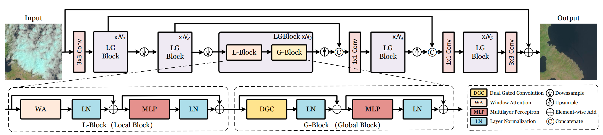
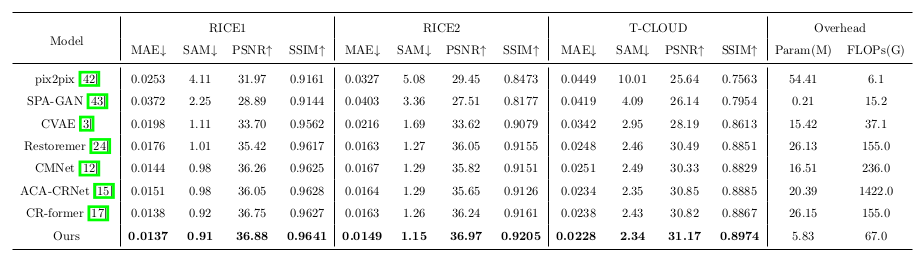
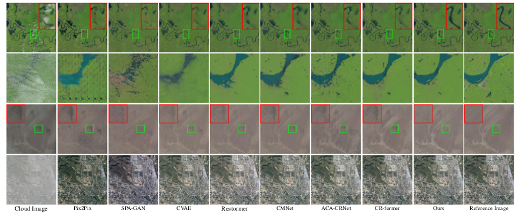

# LGNet: Explicit Local-Global Feature Modeling for Cloud Removal

Ye Deng, Zhihao Li, Peng Wang, Weiping Ding, Long Chen, Hangjun Ye, Weilong Wang, Xiaoshuai Hao*, 2026

## Abstract

Designing neural network architectures that can effectively extract feature information from remote sensing images is crucial for high-quality cloud removal. Image features can generally be categorized as local and global features. Existing methods typically handle local features using window attention or convolution, but face challenges in modeling global dependencies. We propose **Dual Gated Convolution (DGC)** to efficiently learn non-local dependencies in the frequency domain using Fourier theory. Based on DGC, we develop a **Local-Global Block (LGBlock)** that explicitly models local and global dependencies by combining window attention with adaptive convolutional mechanisms. We further introduce **LGNet**, a U-Net-style cloud removal framework built on LGBlock. Experiments on public datasets demonstrate its effectiveness.



## Installation

**Requirements**

- Python 3.9.0
- PyTorch 1.13.1
- NVIDIA GPU with [CUDA 11.7](https://developer.nvidia.com/cuda-downloads)

Clone the repository (replace `<YOUR-REPOSITORY-URL>` with the actual GitHub URL):

```bash
git clone <YOUR-REPOSITORY-URL>
cd LGNet
```

Create and activate the Conda environment:

```bash
conda env create -f LGNet-env.yml -n LGNet
conda activate LGNet
```

## Contents

1. [Datasets](#datasets)
2. [Models](#models)
3. [Training](#training)
4. [Testing](#testing)
5. [Results](#results)
6. [Citation](#citation)
7. [License](#license)
8. [Acknowledgements](#acknowledgements)

## Datasets

- **RICE-I:** 500 pairs of thin-cloud and cloud-free images obtained from Google Earth. [Dataset](https://github.com/BUPTLdy/RICE_DATASET)
- **RICE-II:** 736 pairs of Landsat 8 OLI/TIRS images, including cloudy, cloud-free, and cloud-mask images. Masks are generated from the Landsat Level-1 quality band. Corresponding cloudy and cloud-free observations are acquired within a maximum interval of 15 days. [Dataset](https://github.com/BUPTLdy/RICE_DATASET)
- **T-CLOUD:** 2,939 paired Landsat 8 RGB images for thin-cloud removal, cropped into 256 × 256 patches. The dataset includes 2,351 training pairs and 588 testing pairs. [Dataset](https://github.com/haidong-Ding/Cloud-Removal)
- **SEN12MS-CR:** Approximately 110,000 samples from 169 geographically distinct regions, with cloudy and cloud-free Sentinel-2 images and corresponding Sentinel-1 SAR images. [Dataset](https://mediatum.ub.tum.de/1554803)

Download the training and testing datasets and place them in the corresponding subdirectories of `./datasets/`. Check the configuration files for the expected directory structure.

## Models

| Dataset | Pretrained weights                                                                     |
| ------- | -------------------------------------------------------------------------------------- |
| RICE-I  | [Baidu Netdisk (code: yg1a)](https://pan.baidu.com/s/1oK_UyIMFdLFq7MzsaRBa_A?pwd=yg1a) |
| RICE-II | [Baidu Netdisk (code: ngke)](https://pan.baidu.com/s/1rLhQ41Qli23L_D0H8nI2vA?pwd=ngke) |
| T-CLOUD | [Baidu Netdisk (code: ebmg)](https://pan.baidu.com/s/10VyNIwJDyGNSoqE0UlDAvA?pwd=ebmg) |

## Training

Training configuration files mentioned in the original instructions include `option/RICE1-CR-Former.yml`, `option/RICE2-CR-Former.yml`, and `option/rice1-LGNet.yml`. Verify the filenames against your repository before running the scripts.

- `dataroot_gt` specifies the ground-truth training data directory.
- `name` specifies the experiment name; outputs are generally stored under `./experiments/<name>/`.
- Training experiments are stored in `./experiments/`.

Run the provided training scripts (original setup: 256 × 256 inputs and one A100 GPU):

```bash
# RICE-I
sh train_script/rice1.sh

# RICE-II
sh train_script/rice2.sh

# T-CLOUD
sh train_script/t_cloud.sh
```

Set the model configuration path through the `-opt` argument in the corresponding shell script, if supported by the training entry point.

## Testing

Download the [pretrained models](#models) and place the weights in the directory expected by your testing configuration (for example, `./experiments/`).

Use the RICE-I, RICE-II, or T-CLOUD test dataset, and run:

```bash
# RICE-I
sh test_script/rice1_test.sh

# RICE-II
sh test_script/rice2_test.sh

# T-CLOUD
sh test_script/t_cloud_test.sh
```

Depending on the test entry point, configure these arguments:

- `--opt`: model configuration file.
- `--input_dir`: input images directory.
- `--input_truth_dir`: ground-truth images directory.
- `--result_dir`: reconstructed images output directory.
- `--weights`: pretrained checkpoint path.

The original instructions also refer to an `output` folder as the default results directory. Confirm the actual location in the test scripts.

## Results

Detailed quantitative and visual comparisons are presented in the paper.

<details>

<summary><strong>Quantitative comparison (click to expand)</strong></summary>

Quantitative comparison on four datasets (Table I in the paper). ↓ indicates lower is better; ↑ indicates higher is better. Best results are shown in bold in the original table.

<p align="center">  
    
</p>

</details>

<details>

<summary><strong>Visual comparison (click to expand)</strong></summary>

Visual comparison on RICE-I and RICE-II (Figure 4 in the paper).

<p align="center">  
    
</p>

</details>

## Citation

If this code is helpful in your research, please cite:

```bibtex
@article{deng2026lgnet,
  title     = {LGNet: Explicit Local-Global Feature Modeling for Cloud Removal},
  author    = {Deng, Ye and Li, Zhihao and Wang, Peng and Ding, Weiping and Chen, Long and Ye, Hangjun and Wang, Weilong and Hao, Xiaoshuai},
  journal   = {Applied Soft Computing},
  pages     = {115401},
  year      = {2026},
  publisher = {Elsevier}
}
```

*Please verify the final bibliographic metadata (including volume and DOI) against the published article.*

## License

The code and pretrained models are described as released under the MIT License. See the repository's `LICENSE` file for the authoritative terms. The project is intended for educational and academic research use.

## Acknowledgements

This code is built on [Restormer](https://github.com/swz30/Restormer). We thank the authors for releasing their code.
